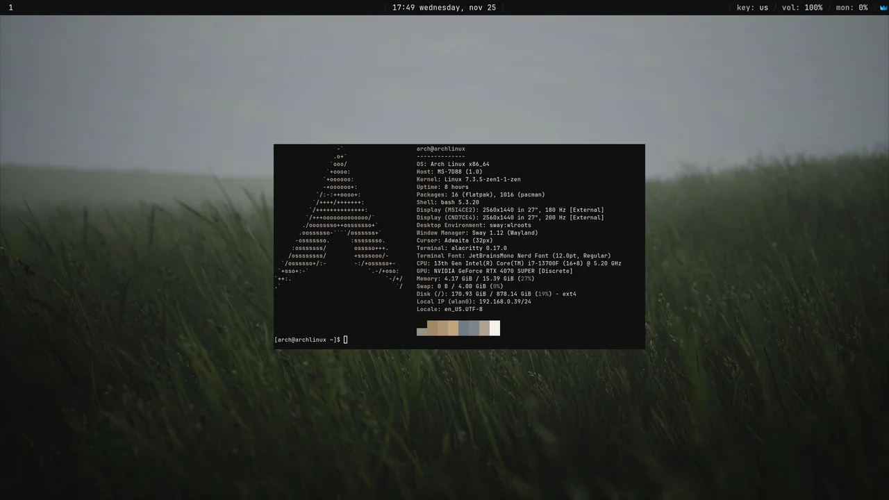
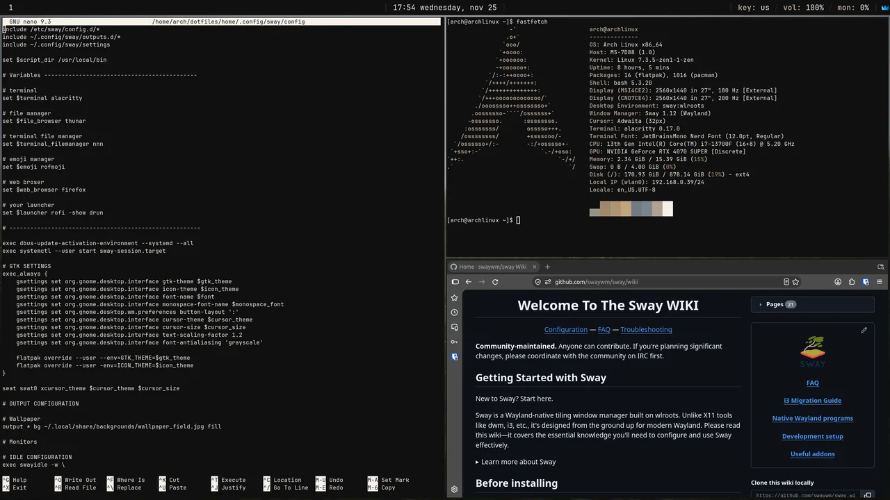
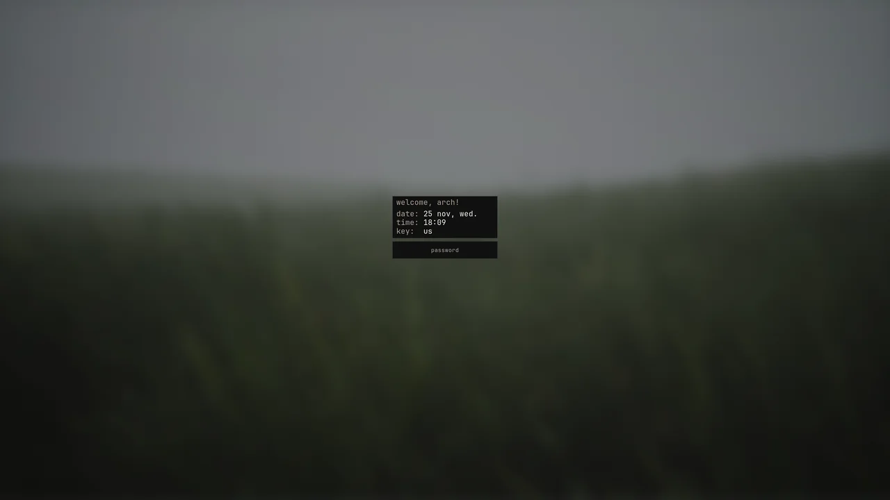
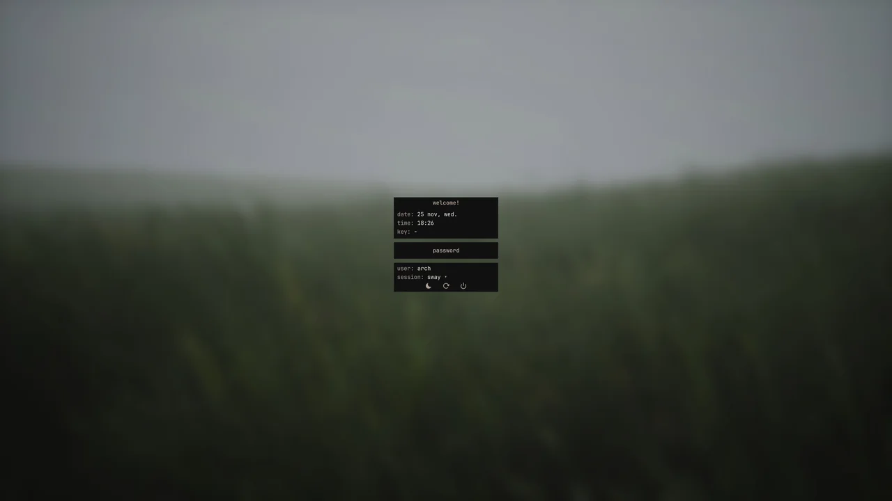

<h1 align="center">Dotfiles</h1>

  

Sway setup based on <a href="https://github.com/martin-djakovic/dotfiles">martin-djakovic/dotfiles</a>

## Installation

On Arch based systems the script installs the packages from [pkglist.txt](pkglist.txt) and [pkglist-aur.txt](pkglist-aur.txt) automatically. On other distributions it only links the configuration files with GNU stow, so install the packages from those lists yourself first (names are from Arch and may differ). The script asks for confirmation before continuing.

~~~bash
git clone https://github.com/zkkzr/dotfiles.git ~/dotfiles
cd ~/dotfiles
sh install.sh
~~~

Alternatively, you can link the files manually with `stow -t ~ home`.

## Keybinds

### General
| Keybind | Action | Default Tool |
| :--- | :--- | :--- |
| `Super+t` | Terminal | Alacritty |
| `Super+b` | Browser | Firefox |
| `Super+.` | Emoji manager | rofimoji |
| `Super+f` | File manager | Thunar |
| `Super+Lalt+f` | Terminal File manager | nnn |
| `Super+Lshift+s` | Screenshooter | Custom script |
| `Super+Lshift+c | Color Picker | hyprpicker | 
| `Super+Enter` | Launcher | rofi drun |

### Window Management
| Keybind | Action |
| :--- | :--- |
| `Super+q` | Kill focused window |
| `Lalt+f4` | Kill focused window |
| `Super+h` | Switch to horizontal tiling |
| `Super+v` | Switch to vertical tiling |
| `Super+Lalt+Space` | Switch focused window between tiling / floating |
| `Super+Mouse1` (Hold) | Drag focused window |

### System
| Keybind | Action |
| :--- | :--- |
| `Super+Lshift+c` | Reload Sway and Waybar |
| `Super+Lalt+q` | Display power menu |
| `Super+l` | Lock session |
| `Super+Shift+e | Exit wayland sesion |

Keybinds are listed under [General Keybinds](https://github.com/zkkzr/dotfiles/blob/main/home/.config/sway/config#L89) Section In main sway config

Default apps are listed in [sway/settings](https://github.com/zkkzr/dotfiles/blob/main/home/.config/sway/settings#L9)

## Notes

- **Monitors:** Configurations are located in `~/.config/sway/outputs.d/local` (not tracked by git).
- **Backgrounds:** Wallpapers are stored in `~/.local/share/backgrounds`.

## Gallery

### Tiled Windows

  

### Locked Screen

  

### SDDM Greeter

  

## Licenses

Original files in this repository (configs, scripts, SDDM theme) are licensed under the MIT License, see `LICENSE`. Third-party material keeps its own license:

- **Base configuration:** [martin-djakovic/dotfiles](https://github.com/martin-djakovic/dotfiles), no license specified upstream.
- **Yaru-Amber** (`home/.local/share/themes`): fork of [Yaru](https://github.com/ubuntu/yaru) taken from the base repository. Yaru assets are CC BY-SA 4.0, scripts are GPL-3.0.
- **cava shaders** (`home/.config/cava/shaders`): MIT, © rezky_nightky, see headers in the files.
- **Papirus** (GPL-3.0), **JetBrains Mono Nerd Font** (OFL-1.1), **Ubuntu font** (Ubuntu Font Licence 1.0): installed from packages.
- **Wallpapers** (`home/.local/share/backgrounds`): authors and licenses are unknown. If you are the author and want wallpaper removed, please open an issue.

## Credits

### Base
This repository is the base for these dotfiles.

Source: [martin-djakovic/dotfiles](https://github.com/martin-djakovic/dotfiles)  

### Sounds

#### AOSP
Notification sounds are sourced from AOSP (Android Open Source Project) (`platform/frameworks/base`, `data/sounds`) and converted from `.ogg` to `.wav`:

- `Notification.wav`: `notifications/ogg/Selenium.ogg`
- `Warning.wav`: `notifications/ogg/Syrma.ogg`

Source: [AOSP/platform/frameworks/base/+/5ac72a2/data/sounds/](https://android.googlesource.com/platform/frameworks/base/+/5ac72a2/data/sounds/)
